# Ambientes de Desenvolvimento de Software — evidências

**Aluno:** Bruno Vasconcelos Rocha — **Matrícula:** 2612659
**Disciplina:** Ambientes de Desenvolvimento de Software (UNIFOR)
**Projeto usado como base:** Sistema de Controle de Biblioteca (React + Node/Express + SQLite)

Cada item do enunciado é apresentado com a ferramenta usada no projeto e o print que comprova.

## 1. Ambiente de gestão — Trello

Quadro **"Gestão do projeto Biblioteca UNIFOR"** com as listas Backlog, Em desenvolvimento, Em testes e Concluído, usado para controlar as tarefas do projeto.

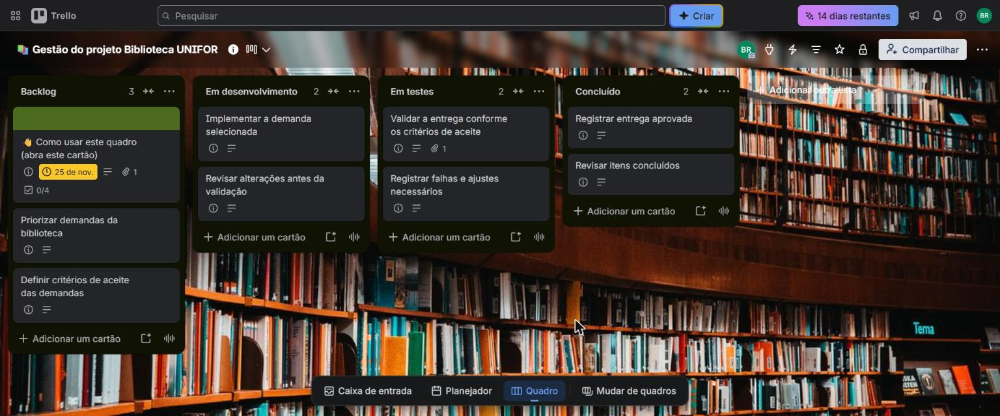

## 2. Ambiente de design de interfaces (UI/UX) — Figma

Arquivo **"Design biblioteca UNIFOR"** no **Figma** com o protótipo das quatro telas do sistema (Login, Acervo, Empréstimos e Usuários), em quadros de 1100 × 700 px, no visual branco e azul da aplicação.

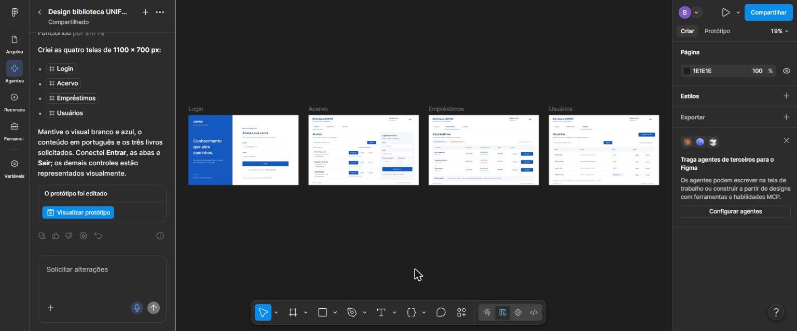

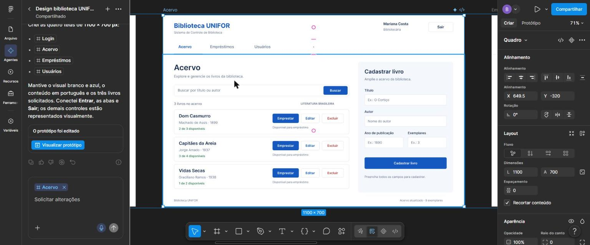

## 3. Ambiente de desenvolvimento — IDE

Projeto `app-nuvem-unifor` aberto no **Visual Studio Code**, com as pastas `backend/`, `frontend/` e `docs/` no Explorador, controle de versão Git (branch `main`) na barra inferior e a extensão Claude Code instalada.

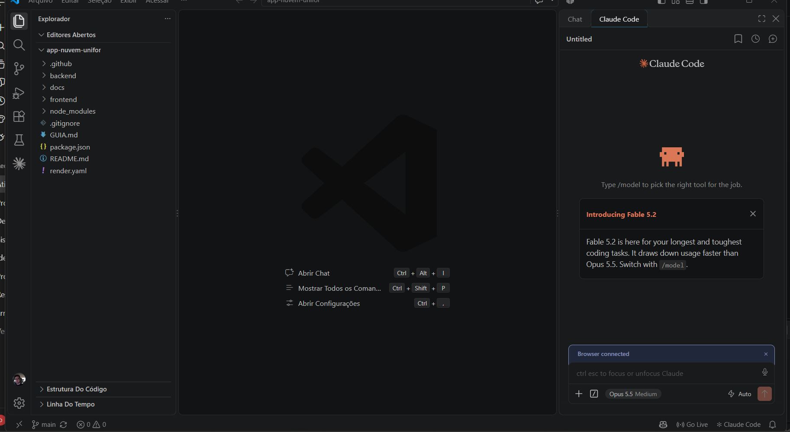

## 4. Ambiente de gestão de banco de dados — cliente SQLite

Banco `biblioteca.sqlite` (SQLite) aberto no **sqlite-web**, cliente web de banco de dados: lista de tabelas, conteúdo da tabela `livros` e estrutura da tabela `usuarios`.

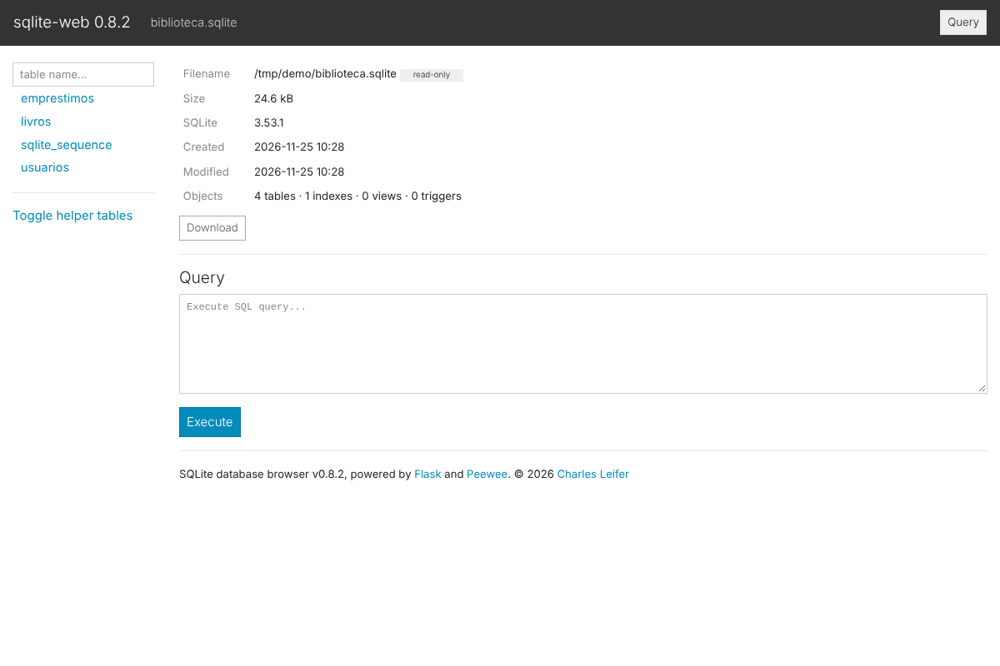

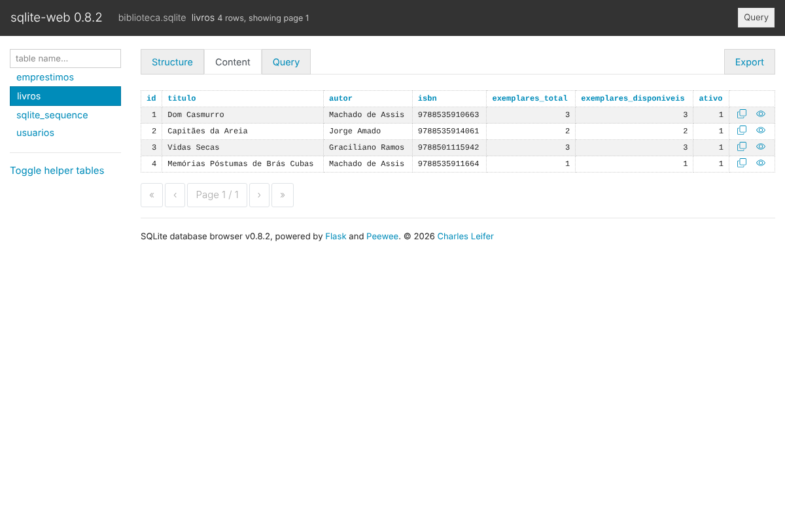

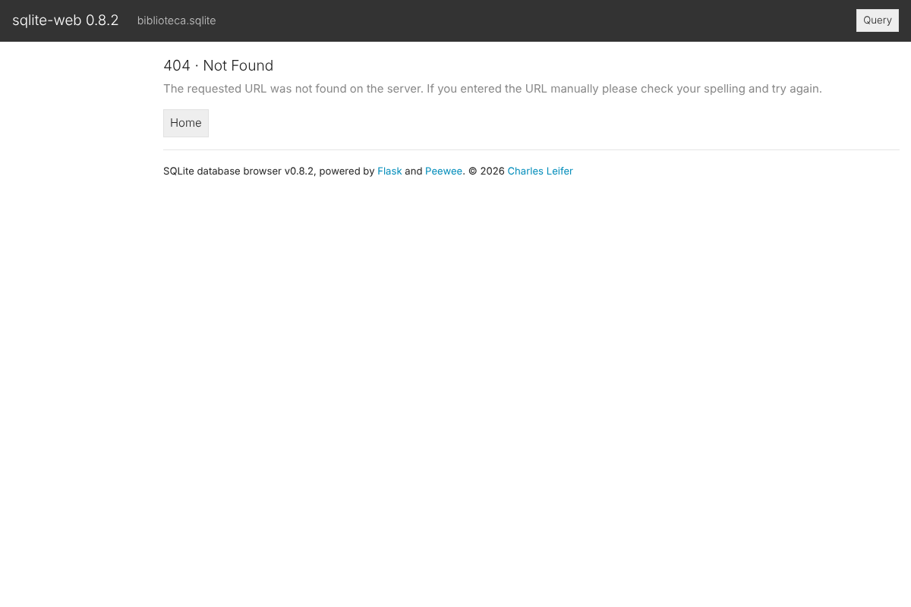

## 5. Ambiente de testes

**Testes formais da API (`node:test` + `supertest`):** 19 testes, todos aprovados (`npm test`).

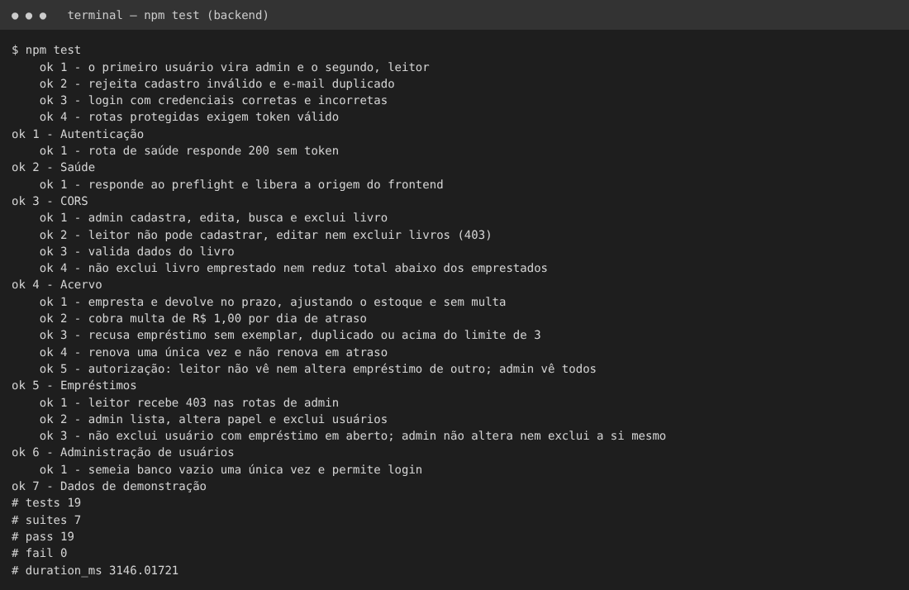

**Teste de interface com Selenium:** o script está em `e2e/teste_selenium.py` (login, acervo, empréstimo e listagem de empréstimos). Os prints gerados pela execução ficam em `docs/ambientes/selenium/`.

Execução (`pip install selenium` e `python e2e/teste_selenium.py`, com o servidor local rodando em `http://localhost:3000`): todas as etapas aprovadas.

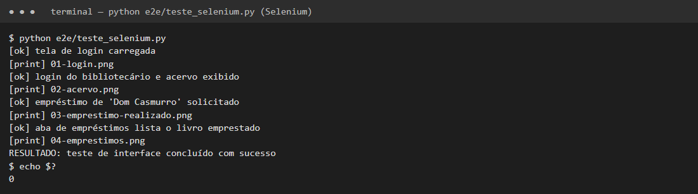

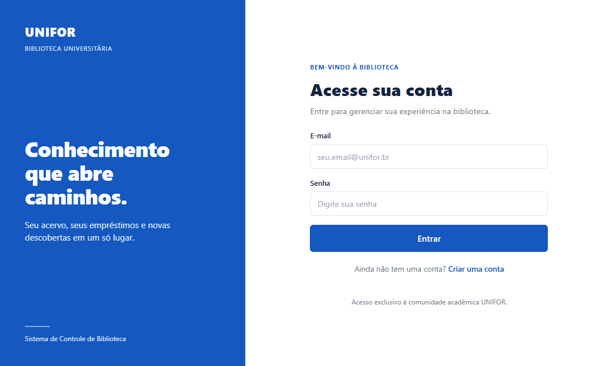

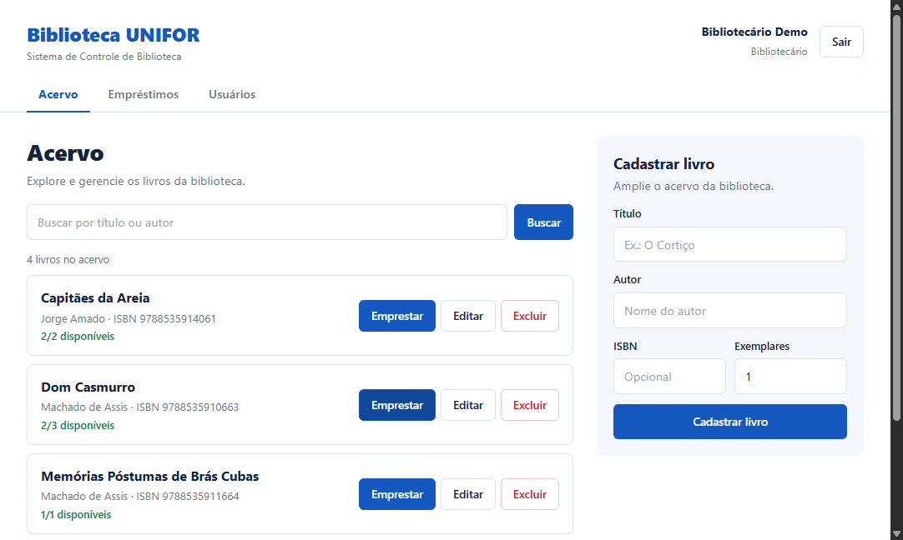

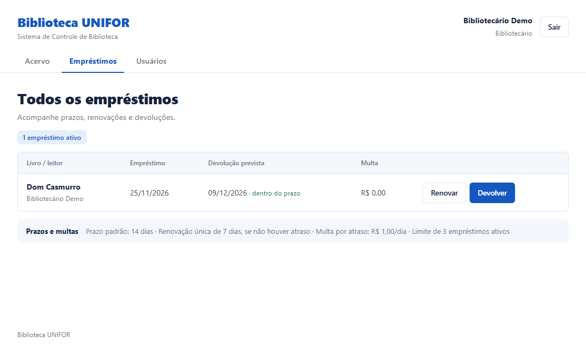

## 6. Ambiente de execução e servidores web

- **Servidor local (Node.js/Express):** `npm start` serve a API REST e o frontend React em `http://localhost:3000`.

  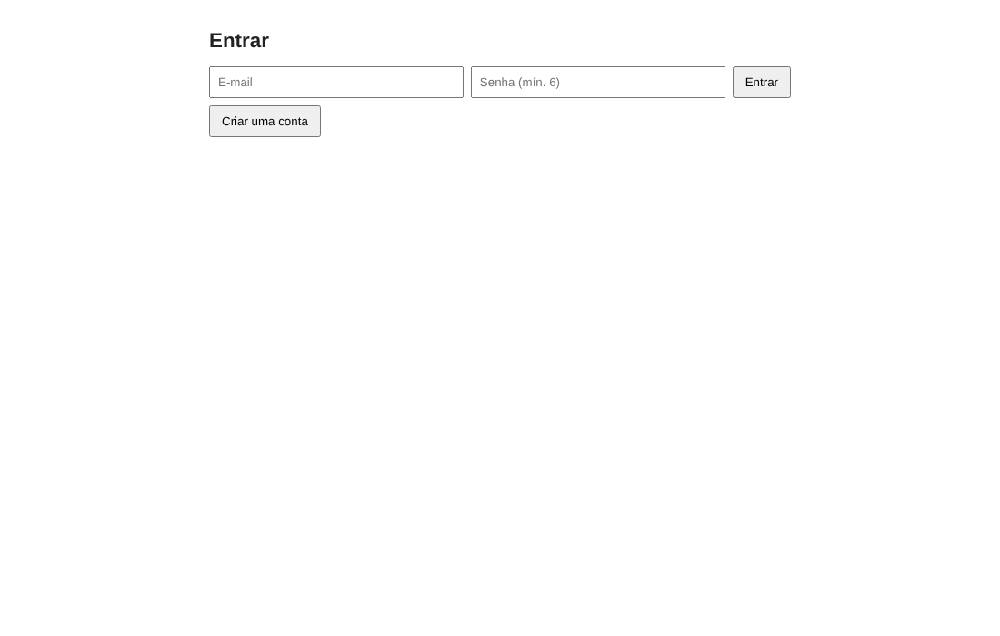

  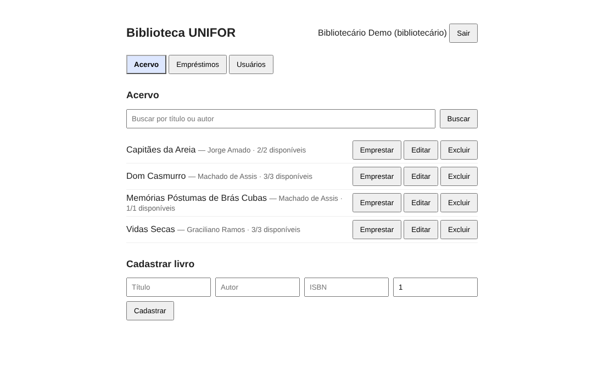

- **Servidores na nuvem:** API REST no **Render** e frontend no **Azure Static Web Apps** (prints em `docs/telas/`).

  

  

## Observação

Os prints do terminal (testes) foram gerados a partir da saída real de `npm test`, e os do sqlite-web e da aplicação local foram capturados com a aplicação em execução, usando o banco de demonstração criado por `SEED_SENHA`.
